# System Architecture

The **Mobile AI Assistant** platform is a privacy-first, on-device agentic AI platform engineered for native Android. It combines native C++ inference acceleration (`llama.cpp`), an autonomous agent orchestration runtime, a multi-protocol dynamic UI ecosystem (GenUI, OpenUI Lang, Google A2UI), Model Context Protocol (MCP) tool bridging, and a comprehensive benchmarking and observability harness.

---

## 1. High-Level Architecture Diagram

```mermaid
flowchart TD
    subgraph UI_Layer [Presentation & UI Layer]
        ComposeUI[Jetpack Compose Material 3 UI]
        ChatScreen[ChatScreen]
        BenchmarkUI[Benchmark & Eval Screens]
        TraceUI[Trace Observability Screen]
        GenUIRenderer[GenUI Native Cards]
        OpenUIRenderer[OpenUI Lang Compose Trees]
        A2UIRenderer[Google A2UI v0.8 Surfaces]
    end

    subgraph Coordination_Layer [ViewModel & Coordination Layer]
        AppVM[ChatViewModel Coordinator]
        DotCoord[DotSessionCoordinator]
        StreamCoord[StreamingGenerationCoordinator]
        ToolCoord[ToolExecutionCoordinator]
        TaskCoord[AgentTaskCoordinator]
        GenUiCoord[GenUiCoordinator]
        OpenUiCoord[OpenUiCoordinator]
        A2UiCoord[A2UiCoordinator]
        MetricsCoord[RuntimeMetricsCoordinator]
    end

    subgraph Domain_Layer [Domain Logic & Agentic Engine]
        AgentLoop[Observe-Plan-Act-Verify-Recover Loop]
        AgentPlanner[AgentPlanner]
        ToolReg[ToolRegistry]
        McpManager[McpServerManager]
        EvalEngine[EvaluationEngine]
        BenchRunner[BenchmarkRunner]
        TraceMgr[TraceManager Ring Buffer]
        BudgetMgr[TokenBudgetManager]
    end

    subgraph Data_Layer [Data & Persistence]
        StorageMgr[ReliableStorageManager Atomic & SHA256]
        DotRepo[DotRepository]
        ChatRepo[ChatRepository]
        TaskRepo[TaskRepository & Checkpoints]
        AuditLogger[ToolAuditLogger]
    end

    subgraph Native_Layer [Inference Runtime & Systems Bridge]
        LocalEngine[LocalInferenceEngine]
        RemoteEngine[RemoteInferenceEngine]
        JNIBridge[JNI C++ Bridge]
        LlamaNative[llama.cpp Native Shared Libs arm64-v8a / x86_64]
        GGUF[Quantized GGUF Models Q4_K_M / Q8_0]
    end

    ComposeUI --> AppVM
    AppVM --> DotCoord
    AppVM --> StreamCoord
    AppVM --> ToolCoord
    AppVM --> TaskCoord
    AppVM --> GenUiCoord
    AppVM --> OpenUiCoord
    AppVM --> A2UiCoord
    AppVM --> MetricsCoord

    StreamCoord --> LocalEngine
    StreamCoord --> RemoteEngine
    LocalEngine --> JNIBridge
    JNIBridge --> LlamaNative
    LlamaNative --> GGUF

    TaskCoord --> AgentLoop
    AgentLoop --> AgentPlanner
    AgentLoop --> ToolCoord
    ToolCoord --> ToolReg
    ToolReg --> McpManager

    DotCoord --> DotRepo
    AppVM --> ChatRepo
    TaskCoord --> TaskRepo
    ToolCoord --> AuditLogger

    DotRepo --> StorageMgr
    ChatRepo --> StorageMgr
    TaskRepo --> StorageMgr

    StreamCoord --> TraceMgr
    StreamCoord --> MetricsCoord
    RemoteEngine --> BudgetMgr
```

---

## 2. Architectural Layers & Boundaries

### 2.1 Native Systems Layer (`:llama-cpp-bridge`)
- **Native JNI Engine:** Direct C++17 integration with `llama.cpp`. Compiles into shared libraries (`libllama-android.so`) optimized with ARM NEON SIMD intrinsics and FP16 vector instructions.
- **Opaque Pointers:** Memory handles (`modelPointer`, `contextPointer`) remain in native memory, referenced strictly via 64-bit integer addresses to avoid JVM garbage collection churn.
- **Zero-Allocation Token Streaming:** Token generation invokes native-to-JVM callbacks directly mapped to Kotlin `Flow<GenerationEvent>`, streaming chunks immediately to the UI thread without blocking inference threads.

### 2.2 Domain & Agentic Runtime Layer
- **Autonomous Cognitive Loop:** Implements the six-step sequence:
  $$\text{Observe} \longrightarrow \text{Understand} \longrightarrow \text{Plan} \longrightarrow \text{Act} \longrightarrow \text{Verify} \longrightarrow \text{Recover}$$
- **Schema Validation & Planning:** `AgentPlanner` validates LLM-generated JSON plans against registered tool schemas. Hallucinated tools or parameters trigger immediate replanning or typed errors.
- **Model Context Protocol (MCP):** Connects to remote/local tool providers over Streamable HTTP (JSON-RPC 2.0). Automatically translates tool definitions into native invocations and enforces per-Dot authorization.
- **Task Recovery:** `TaskCheckpoint` instances save step state, variable bindings, and execution artifacts. Background task termination or OS process kills trigger automatic state restoration via `TaskRecoveryCoordinator`.

### 2.3 Presentation & Decomposed Coordinators
The presentation layer decomposes traditional monolithic ViewModels into 10 decoupled coordinators:
1. `DotSessionCoordinator`: Manages active persona, memory retrieval, prompt injection, and permission isolation.
2. `ChatSessionCoordinator`: Session lifecycle, history serialization, and message state.
3. `StreamingGenerationCoordinator`: Generation dispatch, delta aggregation, error boundaries, and trace event emission.
4. `GenUiCoordinator`: Custom JSON card parsing and state repair.
5. `OpenUiCoordinator`: OpenUI Lang AST parsing and declarative state binding.
6. `A2UiCoordinator`: Google A2UI v0.8 surface lifecycles and JSONL stream resolution.
7. `ToolExecutionCoordinator`: Human-in-the-loop approval requests and audit logging.
8. `AgentTaskCoordinator`: Autonomous multi-step task execution and progress tracking.
9. `VoiceCoordinator`: Speech-to-text input and text-to-speech feedback.
10. `RuntimeMetricsCoordinator`: Real-time TTFT, prefill, decode, and memory utilization metrics.

---

## 3. Data Integrity & Persistence Architecture
- **Atomic File Swapping:** `ReliableStorageManager` prevents corruption during power loss or abrupt OS kills by writing payloads to `.tmp` files, flushing file descriptors via `sync()`, and executing an atomic file rename.
- **Backup Rotation:** Existing files are rotated to `.bak` before target overwrites.
- **SHA-256 Checksumming:** Serialized JSON files are validated with cryptographic checksums; corrupted files trigger automated recovery from `.bak` backups.

---

## 4. Multi-Protocol Generative UI Ecosystem
The platform natively parses and renders three distinct UI paradigms without executing unsafe runtime scripts:
1. **GenUI:** JSON-based schema for structured cards, forms, and parameter displays.
2. **OpenUI Lang:** Markdown-like declarative syntax with nested hierarchies and data binding (`{{state.key}}`).
3. **Google A2UI (v0.8):** Protocol with flat component catalogs, root ID resolution, multi-surface management, and incremental JSONL stream updates.

