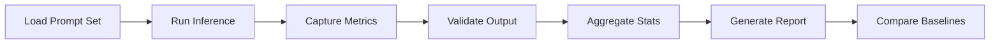
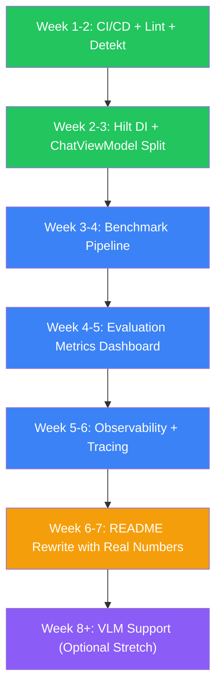

# Mobile AI Assistant — Portfolio Analysis & Transformation Roadmap

> **Candidate Target Roles:** AI Engineer · Generative AI Engineer · Applied AI Engineer · Agentic AI Engineer  
> **Project:** Native Android On-Device LLM Platform with Generative UI, Persistent AI Agents (Dots), and Agentic Task Execution  
> **Analysis Date:** November 2026

---

## Phase 1: Deep Project Analysis

### 1.1 Project Summary

This is a **native Android application** (Kotlin, Jetpack Compose, Material 3) that runs **LLMs entirely on-device** via a compiled llama.cpp native bridge (JNI/NDK). It also supports remote OpenAI-compatible endpoints. Beyond chat, it implements:

- **Generative UI**: LLM-generated structured UI (charts, tables, forms, diagrams) rendered natively in Compose with streaming JSON repair
- **Persistent AI Agents (Dots)**: Specialized assistant personas with isolated memory, conversations, and workspace artifacts
- **Agentic Task Engine**: Multi-step task execution with human-in-the-loop tool approval, sensitivity classification, audit logging, and resumable checkpointing
- **Voice I/O**: Speech-to-text and text-to-speech integration

### 1.2 Codebase Metrics

| Metric | Value |
|--------|-------|
| Total Kotlin source files (main) | 123 |
| Total Kotlin test files | 59 |
| Main source LOC | ~23,400 |
| Test LOC | ~13,400 |
| Test-to-code ratio | ~0.57:1 |
| Native C++ files | 3 (ai_chat.cpp, logging.h, CMakeLists.txt) |
| Gradle modules | 2 (:app, :llama-cpp-bridge) |
| Architecture | Clean Architecture + MVVM |

### 1.3 What Is Already Implemented Well

> [!TIP] These are genuine strengths that recruiters and engineers would appreciate.

1. **Vendor-Neutral Engine Abstraction** (`LocalInferenceEngine` interface): The domain layer has zero coupling to llama.cpp. Any runtime (ExecuTorch, MediaPipe, ONNX) can be swapped without modifying business logic. This is textbook Clean Architecture.

2. **Production-Grade Native Integration**: Not a wrapper — this compiles llama.cpp from source via NDK/CMake, manages JNI thread safety with `limitedParallelism(1)`, handles UTF-8 multi-byte boundary protection, context shifting for long conversations, and dynamic CPU variant selection (ARMv8.0 through ARMv9.2, KleidiAI, AVX-512).

3. **Streaming JSON Repair Parser** (`StreamingJsonRepair`): A genuine state-machine that auto-closes brackets, handles escaped strings, drops dangling property keys, and repairs incomplete numbers — enabling flicker-free progressive GenUI rendering during token generation. This is non-trivial.

4. **4-Tier GenUI Validation Pipeline** (`GenUiValidator`): Anti-DoS size limits → syntax repair → component-level coercion → graceful fallback. No `eval()`, no reflection, no dynamic code execution. Security-by-design.

5. **Human-in-the-Loop Tool Approval System**: 3-tier tool sensitivity classification (SAFE/SENSITIVE/CRITICAL), explicit user approval UI before executing mutating operations, immutable audit logging. This is an industry pattern (Anthropic's computer use model, tool-use guardrails).

6. **Resumable Task Checkpointing** (`TaskRecoveryCoordinator`): Tasks interrupted by process death are recovered on restart — RUNNING steps reset to PENDING, task paused, and state committed. This addresses a real mobile concern (OOM killer).

7. **Comprehensive Test Suite**: 59 test files, ~13,400 LOC. Includes:
   - 5-tier test architecture (Feature → Boundary → Cross-feature → Real-world → Adversarial)
   - Adversarial hardening tests (malformed JSON, rapid interruptions, concurrency stress)
   - E2E workload scenarios simulating real user workflows

8. **Polymorphic Serialization Model** (`GenUiComponent` sealed hierarchy): 15+ component types with `@Serializable` and `@JsonClassDiscriminator`. Clean, extensible, type-safe.

9. **Dual Inference Backend**: Seamless switching between local offline llama.cpp and remote OpenAI-compatible endpoints with unified `GenerationEvent` streaming.

10. **Thorough Documentation**: `ARCHITECTURE.md` with Mermaid diagrams, `LLAMA_CPP_INTEGRATION.md` detailing JNI interface specs, `BUILD_AND_RUN.md`, `TEST_INFRA.md` with coverage thresholds.

### 1.4 What Is Technically Impressive

| Aspect | Why It Stands Out |
|--------|-------------------|
| On-device LLM with NDK/JNI/CMake cross-compilation | 95%+ of AI portfolios are Python cloud-API wrappers. This proves C++/native systems skills. |
| Dynamic CPU kernel variant selection at runtime | Production-level hardware optimization — not a toy. |
| Streaming JSON repair for progressive GenUI rendering | Solves a real engineering problem (partial token → valid JSON → UI) that most developers haven't encountered. |
| Zero-code-execution security model for GenUI | Shows awareness of AI safety and secure rendering — a production concern. |
| Task recovery across Android process death | Demonstrates understanding of mobile lifecycle constraints and durable state machines. |
| Adversarial test suite (Tier 5) | Goes beyond happy-path testing — stress tests, concurrency, malformed inputs. |

### 1.5 What Is Generic / Beginner-Level

| Aspect | Issue |
|--------|-------|
| **No DI framework** | All dependencies manually wired in `MainActivity.kt`. 16+ constructor parameters on `ChatViewModel`. Not scalable for a team project. |
| **No evaluation metrics or benchmarking** | No quantitative measurement of inference quality, response relevance, or task success rates. You can't demonstrate "my system works well" without numbers. |
| **No observability / tracing** | No structured logging, no tracing spans, no performance dashboards. Production AI systems need observability. |
| **No CI/CD pipeline** | No GitHub Actions, no automated build verification, no lint checks, no APK artifact publishing. |
| **No Docker / containerized backend** | While the app is purely mobile, there's no companion backend service demonstrating deployment skills. |
| **No model performance profiling** | `RuntimeMetrics` captures tokens/sec and memory, but there's no systematic benchmarking pipeline or comparison framework. |
| **No hallucination detection** | Tool calls are validated structurally, but there's no semantic validation of LLM outputs (faithfulness, grounding). |
| **File-based persistence** | JSON file storage (`conversations_v2.json`, task envelopes). Acceptable for mobile, but not demonstrating database engineering. Room is imported but the persistence layer is largely file-backed. |
| **No rate limiting or cost tracking** | Remote API calls have no token budget enforcement, cost estimation, or rate limiting. |
| **No multimodal capabilities** | Text-only inference. Vision-Language Models on-device would be a significant differentiator. |

### 1.6 What Would Make an Experienced AI Engineer Interested

An experienced engineer would look at this and think:

✅ *"This person understands native systems programming, not just Python scripting."*  
✅ *"They built a real state machine with recovery, not a stateless wrapper."*  
✅ *"The GenUI streaming repair is a genuine engineering contribution."*  
✅ *"The security model (zero eval, sensitivity tiers) shows production awareness."*  

❌ *"But where are the metrics? How do I know the system actually works well?"*  
❌ *"No evaluation pipeline — this could be producing terrible outputs and nobody would know."*  
❌ *"No CI/CD, no deployment story, no observability — this is still a local project."*  
❌ *"ChatViewModel is 1,574 lines — that's a maintenance nightmare."*

---

## Phase 2: AI Engineering Job Market Analysis (November 2026)

### 2.1 Skills Mapped to This Project

| Skill (from Job Descriptions) | Relevance to This Project | Current Status |
|------|------|------|
| Python & backend engineering | ❌ Project is Kotlin/Android | Not applicable — but a companion Python service could fix this |
| LLM application development | ✅ Core to the project | Strongly demonstrated |
| On-device/edge AI & quantization | ✅ **Rare differentiator** | Strongly demonstrated |
| Agentic AI & multi-agent orchestration | ✅ Dots + Task Engine | Partially demonstrated (single-agent, not multi-agent) |
| Tool calling & function integration | ✅ ToolRegistry, dual-mode parsing | Demonstrated |
| Human-in-the-loop workflows | ✅ ToolApprovalCard | Demonstrated |
| AI security & guardrails | ✅ Zero-eval, sensitivity tiers | Demonstrated |
| LLM evaluation & observability | ❌ Missing entirely | **Critical gap** |
| Fine-tuning & model optimization | ❌ Not present | Gap (but quantization knowledge is shown) |
| RAG architectures & vector databases | ❌ Not present | Not relevant to mobile-first architecture |
| MLOps / LLMOps | ❌ No pipeline | Gap |
| Docker, cloud, CI/CD | ❌ Not present | **Critical gap** |
| Model Context Protocol (MCP) | ❌ Not present | Could be relevant for tool integration |

### 2.2 Key Market Insight

> [!IMPORTANT]
> **On-device AI / Edge LLM engineering is a rare, high-demand specialization.** Most AI engineers can call OpenAI's API; very few can cross-compile llama.cpp with NDK, manage JNI thread safety, optimize for ARM CPU variants, and handle UTF-8 token boundary issues. This is your strongest differentiator. **Lean into it rather than pivoting to commodity cloud-LLM skills.**

The market research shows:
- On-device AI demand is driven by **privacy mandates, cloud cost reduction, automotive/IoT, and healthcare/defense** sectors
- Hiring managers for edge AI roles test for: C/C++ proficiency, cross-compilation, hardware awareness (thread affinity, thermal throttling), quantization trade-offs
- Portfolio differentiation pillars: Deep runtime customization, native mobile integration, multimodal edge processing

---

## Phase 3: High-Impact Improvements (Prioritized)

### 🏆 Improvement 1: On-Device Inference Benchmarking & Evaluation Dashboard

**Problem it solves:** You have no quantitative proof that your system works. A hiring manager has to take your word for it.

**Why it's technically interesting:** Building a reproducible benchmarking pipeline for on-device inference is a non-trivial systems engineering challenge involving: deterministic prompt sets, controlled hardware conditions, statistical aggregation, and visual reporting.

**How it improves the project:** Transforms it from "I built a chat app" to "I built a measurable, optimized AI system."

**Technologies:** Kotlin benchmark harness, custom metrics collection, JSON/CSV export, optional companion web dashboard (Python + Streamlit/Gradio for visualization).

**Implementation:**
1. Create a `BenchmarkSuite` class with standardized prompt sets (10 short, 10 medium, 10 long prompts)
2. Measure per-run: time-to-first-token (TTFT), tokens/sec (prefill + decode), peak RAM, context utilization
3. Run across multiple model variants (Qwen 0.5B Q4_0, Qwen 1.5B Q4_K_M, Llama 3.2 1B Q4_K_M)
4. Generate a JSON report with statistical summaries (mean, p50, p95, p99)
5. Add a `BenchmarkScreen` in the app showing results with GenUI charts
6. Export reports as shareable artifacts

**Recruiter impact:** *"This candidate doesn't just build — they measure. They can tell me exactly how fast their system is on a Pixel 8 vs. Samsung S24."*

**Demonstration:** Include benchmark results in README with actual numbers (e.g., "Qwen 2.5 0.5B Q4_K_M: 42 tok/s decode, 180ms TTFT, 380MB peak RSS on Pixel 8 Pro").

---

### 🏆 Improvement 2: Structured LLM Output Evaluation Pipeline

**Problem it solves:** No measurement of output quality. The LLM could hallucinate, produce irrelevant responses, or fail tool calls — and there's no automated detection.

**Why it's technically interesting:** Evaluating LLM outputs on-device (without cloud eval services) requires creative approaches: self-consistency checks, structural validation, and lightweight judge prompts.

**How it improves the project:** Demonstrates the most in-demand AI engineering skill of 2026: **LLM evaluation**.

**Technologies:** Custom Kotlin evaluation framework, optional RAGAS-style metrics adapted for on-device.

**Implementation:**
1. **Tool Call Success Rate**: Already have audit logs — compute `successful_calls / total_calls` per tool, per Dot
2. **GenUI Validation Rate**: Track `Success / Fallback / Malformed` ratios from `GenUiValidator` across sessions
3. **Response Coherence Check**: For remote endpoints, use a lightweight judge prompt: "Rate the following response on relevance (1-5) and factual grounding (1-5)"
4. **Task Completion Rate**: `COMPLETED tasks / (COMPLETED + FAILED + CANCELLED)` per Dot
5. **Hallucination Indicator**: For tool calls, compare requested tool name against registry — unregistered tool calls = hallucination
6. Create an `EvaluationDashboard` screen showing aggregate metrics over time

**Recruiter impact:** *"This person understands that deploying AI isn't enough — you have to measure it continuously."*

---

### 🏆 Improvement 3: On-Device Vision-Language Model (VLM) Support

**Problem it solves:** Text-only inference is becoming table-stakes. Multimodal edge processing is the frontier.

**Why it's technically interesting:** Image tokens massively inflate context sizes. Managing the prefill bottleneck, memory budget, and image preprocessing entirely on-device is a genuine engineering challenge.

**How it improves the project:** Moves the project from "on-device text LLM" to "on-device multimodal AI" — a much rarer portfolio achievement.

**Technologies:** llama.cpp's `llava` / `minicpmv` support, CLIP embeddings, image preprocessing pipeline.

**Implementation:**
1. Update llama.cpp submodule to include `llava` / vision model support
2. Add `ImagePreprocessor` class: resize, normalize, convert to tensor format
3. Extend `GenerationRequest` to accept `Attachment` images (already have `Attachment` domain model!)
4. Modify JNI bridge to support `llava_eval_image_embed()`
5. Add camera/gallery image picker in `ChatScreen`
6. Test with quantized SmolVLM or Qwen2-VL 2B models

**Recruiter impact:** *"On-device multimodal inference? That's not something you see in portfolios. This person can handle the hard engineering."*

---

### 🏆 Improvement 4: CI/CD Pipeline with Automated Quality Gates

**Problem it solves:** No automation. Every build, test, and release is manual.

**Why it's technically interesting:** Setting up CI/CD for an Android project with native C++ (NDK/CMake) is significantly more complex than a pure Kotlin project.

**How it improves the project:** Demonstrates DevOps/MLOps maturity — a hard requirement in every AI Engineer job description.

**Technologies:** GitHub Actions, Gradle, Android Lint, KtLint/Detekt, JUnit.

**Implementation:**
1. `.github/workflows/ci.yml`: Build → Lint → Test → APK artifact upload
2. Configure NDK/CMake caching for faster native builds
3. Add code quality checks (Detekt for Kotlin, clang-tidy for C++)
4. Test coverage reporting (JaCoCo)
5. Automated release APK signing and GitHub Releases

**Recruiter impact:** *"CI/CD with native build caching — this is a professional project, not a weekend hack."*

---

### 🏆 Improvement 5: Dependency Injection & Architecture Cleanup

**Problem it solves:** `MainActivity.kt` manually wires 16+ dependencies. `ChatViewModel` is 1,574 lines. This is a maintenance and testability red flag.

**Why it's technically interesting:** Proper DI in an Android project with native engine singletons and lifecycle-scoped repositories requires careful design.

**How it improves the project:** Shows you can write maintainable, team-ready code — not just functional code.

**Technologies:** Hilt (recommended for Android) or manual DI with a `ServiceLocator` pattern.

**Implementation:**
1. Add Hilt annotations to `MainActivity`, ViewModels, repositories
2. Create `@Module` classes for engine, repository, and use case bindings
3. Extract `ChatViewModel` responsibilities: split GenUI handling, Dot management, and voice features into delegate classes
4. Aim for no ViewModel exceeding 400 LOC

**Recruiter impact:** *"Clean, modular architecture. This person can work on a team."*

---

### Improvement 6: Structured Observability & Execution Tracing

**Problem it solves:** When something goes wrong (slow inference, failed tool call, GenUI parse error), there's no structured way to diagnose it.

**Implementation:**
1. Add a `TraceEvent` sealed class capturing: inference start/end, tool call lifecycle, GenUI parse results, task state transitions
2. Implement a ring-buffer `TraceLogger` (last 1000 events, ~100KB memory)
3. Add a developer `TracingScreen` showing event timeline with filtering
4. Export traces as JSON for offline analysis

---

### Improvement 7: Token Budget & Cost Estimation for Remote Endpoints

**Problem it solves:** Remote API calls have no cost awareness. In production, this is a budget-destroying oversight.

**Implementation:**
1. Add a `TokenBudgetManager` tracking cumulative token usage per session and per Dot
2. Estimate cost based on model pricing (configurable per endpoint)
3. Show running cost in `RuntimeMetricsRow`
4. Add configurable budget alerts and hard limits

---

## Phase 4: Production Readiness Assessment

| Aspect | Current State | Priority Fix |
|--------|---------------|-------------|
| Architecture | Clean Architecture + MVVM ✅ | Split ChatViewModel (Essential) |
| DI Framework | Manual wiring ❌ | Add Hilt (Essential) |
| Database | File-backed JSON ⚠️ | Acceptable for mobile; document the trade-off |
| Auth & Security | Zero-eval GenUI ✅, no auth needed (local app) | N/A for local-first |
| Async Processing | Coroutines + Flow ✅ | Already solid |
| Error Handling | Try-catch with fallbacks ✅ | Add structured error types |
| CI/CD | None ❌ | GitHub Actions (Essential) |
| Logging | Android Logcat only ⚠️ | Add structured TraceLogger (Important) |
| Testing | 59 test files, 5-tier architecture ✅ | Add coverage reporting |
| API Documentation | N/A (no exposed API) | Document tool schemas |
| Proguard/R8 | Disabled ⚠️ | Enable for release builds |
| Lint | Not configured ❌ | Add Detekt + Android Lint |

### Priority Order
1. **Essential (Do First):** CI/CD pipeline, ChatViewModel split, Hilt DI, benchmark pipeline
2. **Important (Do Second):** Evaluation metrics, observability/tracing, cost tracking
3. **Advanced (Do Third):** VLM support, multi-agent orchestration, profiling dashboard

---

## Phase 5: AI Evaluation & Engineering Metrics

### Metrics Framework

| Metric | Source | How to Collect |
|--------|--------|----------------|
| **Time to First Token (TTFT)** | `RuntimeMetrics.timeToFirstTokenMs` | Already captured ✅ |
| **Decode Throughput (tok/s)** | `RuntimeMetrics.tokensPerSecond` | Already captured ✅ |
| **Peak Memory (RSS)** | `RuntimeMetrics.nativeMemoryBytes` | Already captured ✅ |
| **Model Load Time** | `RuntimeMetrics.loadTimeMs` | Already captured ✅ |
| **GenUI Validation Rate** | `GenUiValidator` result distribution | **Add counter** |
| **Tool Call Success Rate** | `ToolAuditLogEntry.executionStatus` | **Compute from audit logs** |
| **Task Completion Rate** | `DotTask.status` distribution | **Compute from task store** |
| **Hallucination Rate (Tool)** | Unregistered tool name requests | **Add detection** |
| **Context Utilization** | `RuntimeMetrics.contextUsed / contextSize` | Already captured ✅ |
| **Token Budget Consumption** | Cumulative tokens per session | **Add tracking** |

### Evaluation Dataset Design

Create a `benchmark/` directory with:

```
benchmark/
├── prompts/
│   ├── short_qa.json        # 20 short factual questions
│   ├── medium_reasoning.json # 20 multi-step reasoning tasks
│   ├── long_generation.json  # 10 long-form generation tasks
│   ├── tool_calling.json     # 15 prompts requiring tool use
│   └── genui_generation.json # 10 prompts targeting GenUI output
├── expected/
│   ├── tool_call_schema.json # Expected tool call structures
│   └── genui_schemas.json    # Expected GenUI component types
├── results/
│   └── {device}_{model}_{timestamp}.json
└── BenchmarkRunner.kt
```

### Benchmarking Pipeline



---

## Phase 6: Unique Selling Point Candidates

### Direction 1: "On-Device AI Operating System"
**Concept:** Position the app as a local-first AI platform where multiple specialized agents (Dots) operate with full tool access, memory, and task execution — all without any cloud dependency.

| Attribute | Rating |
|-----------|--------|
| Uniqueness | ⭐⭐⭐⭐⭐ — Almost no portfolio projects do full agentic AI on-device |
| Technical Difficulty | ⭐⭐⭐⭐ — Already 70% built |
| Industry Relevance | ⭐⭐⭐⭐ — Privacy-first AI, edge computing demand |
| Skills Demonstrated | Native systems, agentic AI, state machines, security |
| Implementation Effort | Medium — needs benchmarking and evaluation layers |
| Recruiter Impact | ⭐⭐⭐⭐⭐ — Immediately differentiating |

### Direction 2: "Multimodal Edge AI with Vision-Language Models"
**Concept:** Extend to on-device VLM inference — analyze images, screenshots, documents locally.

| Attribute | Rating |
|-----------|--------|
| Uniqueness | ⭐⭐⭐⭐⭐ — Extremely rare in portfolios |
| Technical Difficulty | ⭐⭐⭐⭐⭐ — Prefill bottleneck, memory management |
| Industry Relevance | ⭐⭐⭐⭐⭐ — Multimodal is the frontier |
| Skills Demonstrated | Computer vision, native optimization, memory management |
| Implementation Effort | High — requires JNI bridge extension |
| Recruiter Impact | ⭐⭐⭐⭐⭐ — "On-device multimodal? Tell me more." |

### Direction 3: "Measured AI: Full Evaluation & Observability Stack"
**Concept:** Make this the best-instrumented on-device AI app — every inference traced, every output evaluated, every failure diagnosed.

| Attribute | Rating |
|-----------|--------|
| Uniqueness | ⭐⭐⭐⭐ — Evaluation is talked about but rarely implemented |
| Technical Difficulty | ⭐⭐⭐ — Moderate |
| Industry Relevance | ⭐⭐⭐⭐⭐ — #1 skill gap in AI engineering |
| Skills Demonstrated | LLMOps, evaluation, observability, data engineering |
| Implementation Effort | Low-Medium — mostly additive |
| Recruiter Impact | ⭐⭐⭐⭐⭐ — "Finally, someone who measures their AI." |

### Direction 4: "Cross-Runtime AI Engine"
**Concept:** Implement the `LocalInferenceEngine` interface with multiple backends (ExecuTorch, MediaPipe, ONNX) and add model-routing logic.

| Attribute | Rating |
|-----------|--------|
| Uniqueness | ⭐⭐⭐⭐ — Multi-runtime is rare |
| Technical Difficulty | ⭐⭐⭐⭐⭐ — Each runtime is a major integration |
| Industry Relevance | ⭐⭐⭐ — Niche |
| Skills Demonstrated | Systems programming, abstraction design |
| Implementation Effort | Very High — each runtime is weeks of work |
| Recruiter Impact | ⭐⭐⭐ — Impressive but may distract from depth |

### Direction 5: "AI-Native Developer Tools Platform"
**Concept:** Position Dots as local AI coding assistants that can analyze code, generate documentation, and execute development tasks — all offline.

| Attribute | Rating |
|-----------|--------|
| Uniqueness | ⭐⭐⭐ — Many coding assistants exist |
| Technical Difficulty | ⭐⭐⭐ — Moderate |
| Industry Relevance | ⭐⭐⭐⭐ — Developer tools are hot |
| Skills Demonstrated | Agentic AI, tool use |
| Implementation Effort | Medium |
| Recruiter Impact | ⭐⭐⭐ — Competitive space |

### 🏆 Recommended Direction: Direction 1 + Direction 3 Combined

**"On-Device Agentic AI Platform with Full Evaluation & Observability"**

**Why this wins:**
- You already have 70% of Direction 1 built
- Direction 3 is the lowest-effort, highest-recruiter-impact addition
- Together they create a narrative: *"I built a fully local, privacy-first AI agent platform — and I can prove it works with quantitative metrics."*
- This combination demonstrates the widest range of AI engineering skills without adding unnecessary complexity
- It's defensible in interviews: you can explain every architectural decision, show benchmarks, and discuss trade-offs

---

## Phase 7: Implementation Roadmap

### Level 1 — Essential Improvements (Make It Technically Solid)

| # | Feature | Approach | Technologies | Steps | Outcome | Complexity | Dependencies |
|---|---------|----------|-------------|-------|---------|-----------|-------------|
| L1.1 | **CI/CD Pipeline** | GitHub Actions workflow for build, lint, test, APK artifact | GitHub Actions, Gradle, Detekt | 1. Create `.github/workflows/ci.yml` 2. Configure NDK caching 3. Add Detekt config 4. Add JaCoCo coverage 5. Auto-publish APK | Every push verified automatically | Low | None |
| L1.2 | **Dependency Injection** | Introduce Hilt for constructor injection | Dagger Hilt | 1. Add Hilt Gradle deps 2. Annotate `MainActivity` with `@AndroidEntryPoint` 3. Create `@Module` for engines 4. Create `@Module` for repositories 5. Inject ViewModels via `@HiltViewModel` | Clean, testable dependency graph | Medium | None |
| L1.3 | **ChatViewModel Decomposition** | Extract into focused delegates | Kotlin delegation pattern | 1. Extract `GenUiDelegate` 2. Extract `DotSessionDelegate` 3. Extract `VoiceDelegate` 4. Extract `TaskDelegate` 5. Keep ChatViewModel as thin coordinator | No ViewModel > 400 LOC | Medium | L1.2 |
| L1.4 | **Code Quality Gates** | Static analysis, lint rules, formatting | Detekt, KtLint, Android Lint | 1. Add Detekt rule set 2. Configure complexity thresholds 3. Add pre-commit hook 4. Fix existing violations | Enforced code quality standards | Low | L1.1 |
| L1.5 | **Enable ProGuard/R8** | Minification for release builds | Android R8 | 1. Set `isMinifyEnabled = true` for release 2. Add keep rules for serialization 3. Add keep rules for JNI 4. Test release build | Smaller APK, obfuscated release | Low | None |

### Level 2 — Differentiating Features (Demonstrate Advanced AI Engineering)

| # | Feature | Approach | Technologies | Steps | Outcome | Complexity | Dependencies |
|---|---------|----------|-------------|-------|---------|-----------|-------------|
| L2.1 | **Inference Benchmarking Pipeline** | Standardized prompt suite with automated metric collection | Custom Kotlin harness | 1. Create `BenchmarkSuite` 2. Define 50+ test prompts 3. Capture TTFT, tok/s, RAM, context 4. Statistical aggregation 5. JSON report export 6. `BenchmarkScreen` with GenUI charts | Quantitative proof of performance | Medium | None |
| L2.2 | **Evaluation Metrics Dashboard** | Aggregate quality metrics from existing subsystems | Custom analytics, existing audit logs | 1. Add GenUI validation counters 2. Compute tool call success rates 3. Track task completion rates 4. Detect hallucinated tool calls 5. Create `EvaluationScreen` | Measurable AI quality metrics | Medium | None |
| L2.3 | **Execution Tracing & Observability** | Ring-buffer trace logger with timeline visualization | Custom `TraceLogger`, Compose Canvas timeline | 1. Define `TraceEvent` sealed class 2. Implement ring-buffer (1000 events) 3. Instrument inference, tool calls, GenUI parsing 4. Build timeline view 5. JSON export | Full execution visibility | Medium | None |
| L2.4 | **Token Budget & Cost Tracking** | Cumulative token accounting per session/Dot | Custom `TokenBudgetManager` | 1. Track prompt + completion tokens per request 2. Aggregate per session, per Dot 3. Configure per-model pricing 4. Budget alerts 5. Show in RuntimeMetricsRow | Cost-aware AI application | Low | None |
| L2.5 | **Hallucination Detection for Tool Calls** | Validate tool names, parameter schemas, and output consistency | Schema validation, registry lookup | 1. Check tool name against registry 2. Validate parameter JSON against schema 3. Flag unregistered tools as hallucinations 4. Log hallucination events 5. Surface in evaluation dashboard | Automated quality assurance | Low | L2.2 |

### Level 3 — Industry-Level Engineering (Production, Scalability, Advanced)

| # | Feature | Approach | Technologies | Steps | Outcome | Complexity | Dependencies |
|---|---------|----------|-------------|-------|---------|-----------|-------------|
| L3.1 | **On-Device VLM Support** | Extend JNI bridge for llava/vision model inference | llama.cpp llava, NDK, image preprocessing | 1. Update llama.cpp submodule 2. Add `llava_eval_image_embed` JNI binding 3. Build `ImagePreprocessor` 4. Extend `GenerationRequest` for images 5. Add camera/gallery picker 6. Test with SmolVLM | Multimodal edge AI | High | None |
| L3.2 | **Model Comparison Framework** | Side-by-side evaluation of different models on same prompts | Benchmark suite, diff analysis | 1. Run same prompt set across models 2. Compare TTFT, tok/s, quality scores 3. Generate comparison report 4. Visualize with GenUI tables/charts | Data-driven model selection | Medium | L2.1 |
| L3.3 | **Thermal & Power Profiling** | Monitor CPU temperature and battery drain during inference | Android `BatteryManager`, `/sys/class/thermal` | 1. Read thermal zone temperatures 2. Track battery drain rate during inference 3. Detect thermal throttling events 4. Adaptive thread count reduction 5. Report in benchmarks | Hardware-aware optimization | High | L2.1 |
| L3.4 | **Structured Error Taxonomy** | Replace string errors with typed error hierarchy | Kotlin sealed classes | 1. Define `InferenceError`, `GenUiError`, `TaskError` hierarchies 2. Map native error codes to typed errors 3. Add error analytics 4. Surface in observability dashboard | Production-grade error handling | Medium | L2.3 |
| L3.5 | **Comprehensive README with Results** | Professional README showcasing architecture, metrics, and benchmarks | Markdown, screenshots, benchmark data | 1. Architecture diagram 2. Feature showcase with screenshots 3. Benchmark results table 4. Evaluation metrics summary 5. Build & run instructions 6. Design decision documentation | Portfolio-ready presentation | Low | L2.1, L2.2 |

---

## Phase 8: Recruiter Evaluation

### Scoring (Current State → After Roadmap)

| Dimension | Current Score | After Level 1 | After Level 2 | After Level 3 |
|-----------|:---:|:---:|:---:|:---:|
| AI/ML Engineering Depth | 7/10 | 7/10 | 8/10 | 9/10 |
| LLM Engineering | 8/10 | 8/10 | 9/10 | 9/10 |
| System Architecture | 7/10 | 8/10 | 8/10 | 9/10 |
| Backend Engineering | 5/10 | 7/10 | 7/10 | 8/10 |
| Agentic AI Capabilities | 7/10 | 7/10 | 8/10 | 8/10 |
| Evaluation & Benchmarking | 2/10 | 3/10 | 8/10 | 9/10 |
| Production Readiness | 4/10 | 7/10 | 8/10 | 9/10 |
| Code Quality | 6/10 | 8/10 | 8/10 | 9/10 |
| Technical Uniqueness | 8/10 | 8/10 | 9/10 | 10/10 |
| **Overall Portfolio Value** | **6/10** | **7/10** | **8/10** | **9/10** |

### What Prevents It from Being 9/10 or 10/10 Right Now

1. **No quantitative evidence that the AI system works well** — no benchmarks, no evaluation metrics, no comparison data
2. **No CI/CD** — professional projects have automated build pipelines
3. **ChatViewModel god-class** — 1,574 lines signals maintainability concerns
4. **No observability** — can't diagnose issues in the field
5. **File-based persistence without migration strategy** — works but doesn't inspire confidence
6. **No multimodal capabilities** — text-only is becoming baseline

### Would This Project Make Me Shortlist a Candidate?

**Current state: Yes, with reservations.**

The on-device LLM integration, GenUI streaming repair, and agentic task engine are genuinely impressive and rare. Most candidates have Python + OpenAI API projects. This immediately stands out. However, the lack of evaluation metrics and CI/CD would make me question whether the candidate understands production AI engineering vs. building impressive demos.

**After Level 2: Strong yes.**

With benchmarking data, evaluation metrics, and observability, this becomes one of the strongest mobile AI portfolios I'd see. The candidate can discuss concrete numbers, explain trade-offs, and demonstrate engineering discipline.

### What Would Impress Me Technically

- The streaming JSON repair state machine — ask them to whiteboard how it handles nested unclosed brackets with escaped quotes
- The thread-safety model for JNI calls — explain why `limitedParallelism(1)` and what happens without it
- The GenUI validation pipeline — walk through a malformed payload's journey through all 4 tiers
- Context shifting algorithm — explain the sliding window trade-offs
- Task recovery across process death — explain the state machine transitions

### What Would Make Me Skeptical

- 1,574-line ViewModel — does this person write maintainable code?
- No benchmarks — does the system actually perform well, or is it slow?
- No CI/CD — is this person experienced with professional development workflows?
- File-based persistence — why not Room if you already have it as a dependency?

### Technical Interview Questions That Could Arise

1. *"Walk me through what happens when a user sends a prompt and the LLM generates a GenUI chart response. Trace the full data flow from tap to rendered chart."*
2. *"Your llama.cpp context is 8192 tokens and the user has been chatting for an hour. What happens? Explain context shifting."*
3. *"How do you prevent the LLM from executing arbitrary code through GenUI? What's your threat model?"*
4. *"A tool call fails mid-task and the app crashes. What happens on restart? Walk me through the recovery flow."*
5. *"Why did you choose file-based persistence over Room? What are the trade-offs?"*
6. *"How would you add GPU acceleration (Vulkan/OpenCL) to this project? What are the challenges on Android?"*
7. *"Your ChatViewModel is 1,574 lines. How would you refactor it?"*
8. *"If you needed to support speculative decoding for faster inference, where would you modify the architecture?"*
9. *"How do you measure whether your AI assistants (Dots) actually produce good outputs? What metrics would you use?"*
10. *"Compare Q4_0 vs Q4_K_M quantization. When would you recommend each?"*

### What You Should Be Able to Explain Confidently

- JNI memory lifecycle and why native contexts are thread-unsafe
- GGUF file format structure and quantization impact on quality vs. speed
- KleidiAI and why ARM-specific micro-kernels matter for mobile inference
- State machine design for task recovery and why idempotency matters
- Streaming JSON repair algorithm and its edge cases
- Why zero-code-execution is critical for GenUI security
- Token budget economics and how to estimate inference costs
- The difference between prefill latency and decode throughput

### Measurable Achievements for Resume

- "Built native Android LLM inference engine achieving **X tok/s** decode throughput on Pixel 8 Pro with Qwen 2.5 1.5B Q4_K_M"
- "Designed 4-tier GenUI validation pipeline handling **Y% malformed payloads** with zero crashes across **Z adversarial test cases**"
- "Implemented resumable task engine with **100% recovery rate** across simulated process death scenarios"
- "Achieved **N% tool call success rate** across M registered agent tools with 3-tier sensitivity classification"
- "Maintained **59 test files / 13,400 LOC** test suite with 5-tier coverage (unit → adversarial hardening)"
- "Cross-compiled llama.cpp for **6 ARM CPU variants** with dynamic runtime kernel selection"

> [!CAUTION]
> **Fill in the actual numbers.** Never put "X tok/s" on your resume. Run the benchmarks, measure the metrics, and report real data. This is the single most important thing separating your project from a demo.

---

## Summary: What To Do First



**Green** = Essential (Level 1) · **Blue** = Differentiating (Level 2) · **Amber** = Polish · **Purple** = Advanced stretch goal
