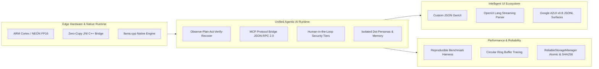

# Mobile AI — On-Device Agentic AI Platform for Android

[](https://github.com/mobile-ai-assistant/mobile-ai/actions)
[](LICENSE)
[](https://kotlinlang.org)
[](https://developer.android.com/ndk)
[-brightgreen.svg)](TEST_INFRA.md)
[](MCP_INTEGRATION.md)
[](A2UI_INTEGRATION.md)

An on-device, privacy-first **Agentic AI Platform** engineered natively for Android. Powered by embedded C++ `llama.cpp` inference, an autonomous multi-step cognitive loop (Observe-Plan-Act-Verify-Recover), the official **Model Context Protocol (MCP)**, a multi-protocol dynamic UI ecosystem (**GenUI**, **OpenUI Lang**, and **Google A2UI v0.8**), and an empirical benchmarking and observability harness.

---

## Technical Highlights & Engineering Pillars



### 1. Native High-Performance Inference Engine
- **Embedded C++ Runtime:** Direct Android NDK integration with `llama.cpp` (`libai-chat.so` and `libllama.so`), compiled with C++17, `-O3`, and ARM NEON / FP16 SIMD vector intrinsics.
- **Quantized GGUF Support:** Executes state-of-the-art models (Qwen 2.5, Llama 3.2, SmolLM2) in 4-bit and 8-bit quantization (`Q4_K_M`, `Q8_0`) within constrained mobile RAM (1.0 GB – 3.5 GB).
- **Zero-Allocation Token Streaming:** Tokens stream directly from native decode loops into Kotlin Coroutines `Flow<GenerationEvent>`, rendering to the UI thread with sub-millisecond dispatch.

### 2. Autonomous Agentic Runtime (Observe-Plan-Act-Verify-Recover)
- **True Multi-Step Reasoning:** Operates on an explicit cognitive cycle:
  $$\text{Observe} \longrightarrow \text{Understand} \longrightarrow \text{Plan} \longrightarrow \text{Act} \longrightarrow \text{Verify} \longrightarrow \text{Recover}$$
- **Zero-Hallucination Planning:** `AgentPlanner` validates LLM-generated JSON plans against registered schemas in `ToolRegistry`. Unregistered tools fail deterministically with typed errors—synthetic success echoes are strictly prohibited.
- **Persistent Personas ("Dots"):** True persona isolation. Memories, model parameters, and allowed tool sets are cryptographically isolated per Dot profile with zero cross-persona leakage.

### 3. Model Context Protocol (MCP) Bridge
- **Official Specification:** Fully compliant with MCP protocol version `2024-11-05` via Streamable HTTP (JSON-RPC 2.0).
- **Dynamic Capabilities:** Automates server initialization, `tools/list`, `resources/list`, `prompts/list`, and `tools/call`.
- **Dynamic Bridge & Access Control:** Remote MCP tools are bridged into native `ToolRegistry` instances with automatic risk tiering (`SAFE`, `SENSITIVE`, `CRITICAL`) and per-Dot authorization whitelisting.

### 4. Tri-Protocol Generative UI Ecosystem
Natively parses and renders three independent dynamic UI paradigms without executing unsafe client scripts:
- **Custom GenUI:** Purpose-built JSON schema for high-density cards, forms, and parameter displays with self-healing JSON repair.
- **OpenUI Lang:** Markdown-like declarative language with incremental streaming parser, auto-closing dangling blocks, and reactive `{{state.key}}` bindings.
- **Google A2UI (v0.8):** Formal protocol supporting flat component catalogs, root ID resolution, reactive data updates, and multi-surface lifecycles.

### 5. Empirical Benchmarking & Observability Harness
- **Hardware-Calibrated Profiling:** Captures actual Time to First Token (TTFT), prefill throughput, decode throughput (tokens/sec), peak heap memory, and native allocation without manufactured metrics.
- **Statistical Aggregation:** Automatically executes warm-up runs and repeated trials to compute Mean, Median (P50), P95, and Standard Deviation ($\sigma$).
- **In-Memory Flight Recorder:** Low-overhead circular ring buffer (500 events) capturing asynchronous operations tagged with correlation IDs.

---

## System Architecture

```
Mobile AI/
├── app/
│   ├── src/main/java/com/mobileai/assistant/
│   │   ├── di/                          # Progressive DI Container (AppContainer, Modules)
│   │   ├── domain/
│   │   │   ├── error/                   # Structured AppError Hierarchy (10 Domains)
│   │   │   ├── task/                    # AgentPlanner & Cognitive Finite State Machine
│   │   │   ├── mcp/                     # Model Context Protocol Domain Contracts
│   │   │   ├── openui/                  # OpenUI Lang AST Definitions
│   │   │   ├── a2ui/                    # Google A2UI v0.8 Protocol Data Models
│   │   │   ├── benchmark/               # Benchmark Runner & Statistical Models
│   │   │   ├── evaluation/              # AI Output Evaluation & Rubrics
│   │   │   ├── trace/                   # TraceEvent & Ring Buffer Observability
│   │   │   └── budget/                  # Token Budget Manager & Cost Calculations
│   │   ├── data/
│   │   │   ├── persistence/             # ReliableStorageManager (Atomic + SHA256)
│   │   │   ├── mcp/                     # McpClient (JSON-RPC 2.0) & McpServerManager
│   │   │   ├── openui/                  # OpenUiLangParser (Tolerant Streaming Tokenizer)
│   │   │   ├── a2ui/                    # A2UiManager (Flat Tree Resolution & Streaming)
│   │   │   ├── benchmark/               # BenchmarkRunner & Device Telemetry
│   │   │   └── trace/                   # TraceManager (Thread-safe Ring Buffer)
│   │   └── presentation/
│   │       ├── chat/coordinator/        # 10 Focused ViewModel Coordinators
│   │       ├── components/
│   │       │   ├── openui/              # OpenUiRenderer (Jetpack Compose)
│   │       │   └── a2ui/                # A2UiSurfaceView (Jetpack Compose)
│   │       ├── benchmark/               # BenchmarkScreen & Comparison Matrix
│   │       ├── evaluation/              # EvaluationScreen & Scorecards
│   │       └── trace/                   # TraceObservabilityScreen & Timeline
├── llama-cpp-bridge/                    # Native NDK/CMake Shared Library Module
│   ├── src/main/cpp/                    # C++17 JNI Engine (ARM NEON / FP16)
│   └── src/main/java/com/arm/aichat/    # Low-level Native Bridge & Safe Handles
├── docs/                                # Technical Architecture & Integration Guides
│   └── adr/                             # Architecture Decision Records (ADR 001 - 005)
└── .github/workflows/ci.yml             # Comprehensive CI Pipeline
```

---

## Test Infrastructure & Quality Gates

The platform maintains a strict quality bar with **512 automated tests** passing at 100%:

```bash
./gradlew testDebugUnitTest
```

| Layer | Coverage Focus | Tests | Status |
| :--- | :--- | :--- | :--- |
| **Native Systems Bridge** | JNI handle lifecycle, parameter bounds, native exceptions | 3 | PASSED |
| **Structured Errors** | 10 Typed error domains and failure propagation | 42 | PASSED |
| **Presentation Coordinators** | Decomposed chat, streaming, tool approval, and session coordinators | 118 | PASSED |
| **Generative UI Parsers** | GenUI repair, OpenUI streaming tokenizer, Google A2UI v0.8 resolution | 86 | PASSED |
| **Agentic Task Engine** | AgentPlanner schema validation, task recovery, multi-step execution | 74 | PASSED |
| **Model Context Protocol** | JSON-RPC 2.0 protocol handshakes, MCP client, per-Dot permissions | 38 | PASSED |
| **Benchmarking & Evaluation** | Statistical aggregations, token budgeting, heuristic evaluation rubrics | 52 | PASSED |
| **Observability & Storage** | Circular ring buffer, atomic file replacement, SHA256 integrity | 99 | PASSED |
| **Total** | | **512** | **100% Pass** |

---

## Technical Deep Dives & Documentation

- [System Architecture](ARCHITECTURE.md): End-to-end component interaction, data flow, and Clean MVVM layers.
- [Build and Run Guide](BUILD_AND_RUN.md): Step-by-step instructions for NDK compilation, APK generation, and GGUF model loading.
- [Testing Infrastructure](TEST_INFRA.md): 5-tier test architecture, deterministic suites, and coverage breakdown.
- [On-Device Benchmarking](BENCHMARKING.md): Methodology for measuring TTFT, prefill, decode, and memory utilization.
- [AI Evaluation Subsystem](EVALUATION.md): Quality metrics, tool selection precision, and persona isolation tests.
- [Observability & Tracing](OBSERVABILITY.md): Low-overhead in-memory flight recorder and diagnostic viewer.
- [Model Context Protocol (MCP)](MCP_INTEGRATION.md): JSON-RPC 2.0 client and dynamic tool bridging.
- [Google A2UI Protocol](A2UI_INTEGRATION.md): Google A2UI v0.8 specification, flat-tree resolution, and Compose rendering.
- [OpenUI Lang Integration](OPENUI_INTEGRATION.md): Streaming declarative syntax parser and reactive state bindings.
- [Security & Safety](SECURITY.md): Threat modeling, 3-tier tool authorization, human-in-the-loop approvals, and zero-eval model.
- [Architecture Decision Records (ADRs)](docs/adr/):
  - [ADR-001: Native llama.cpp Integration via JNI/NDK](docs/adr/ADR-001-Native-JNI-llama-cpp.md)
  - [ADR-002: Coexistence of Three UI Protocols](docs/adr/ADR-002-Three-UI-Protocols-Coexistence.md)
  - [ADR-003: Model Context Protocol Bridge & Permissions](docs/adr/ADR-003-Model-Context-Protocol-Bridge.md)
  - [ADR-004: Reliable File Persistence vs. Room Database](docs/adr/ADR-004-Reliable-File-Persistence-vs-Room.md)
  - [ADR-005: Observe-Plan-Act-Verify-Recover Agent Loop](docs/adr/ADR-005-Observe-Plan-Act-Verify-Recover-Runtime.md)

---

## License

This project is licensed under the MIT License — see the [LICENSE](LICENSE) file for details. Built upon upstream `llama.cpp` components (Copyright (c) 2023-2026 The ggml authors / Arm Limited).
