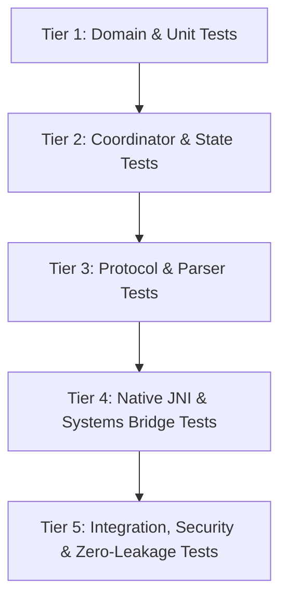

# Testing Infrastructure & Quality Assurance

The Mobile AI Assistant platform employs a rigorous, 5-tier test architecture comprising **512 automated tests** across the native bridge and application layers.

---

## 1. Five-Tier Test Taxonomy



### Tier 1: Domain & Model Unit Tests
- **Objective:** Verify pure business logic, calculations, and data invariants in complete isolation from Android frameworks.
- **Key Suites:**
  - `AppErrorTest`: Exhaustively verifies 10 typed error hierarchies (`InferenceError`, `ModelLoadError`, `StreamingError`, `ToolExecutionError`, `McpError`, `AgentTaskError`, `GenUiError`, `OpenUiError`, `A2UiError`, `PersistenceError`).
  - `BenchmarkModelsTest` & `TokenBudgetManagerTest`: Validates cost calculations, 80% budget warnings, hard spending limits, and statistical aggregations.
  - `EvaluationEngineTest`: Validates quality metrics, schema conformance scoring, and heuristic rubric calculations.

### Tier 2: Coordinator & State Management Tests
- **Objective:** Test decomposed presentation coordinators decoupled from Android UI rendering.
- **Key Suites:**
  - `DotSessionCoordinatorTest`: Verifies active Dot identity switching, dynamic memory injection into prompts, and tool permissions.
  - `StreamingGenerationCoordinatorTest`: Validates token delta accumulation, metrics propagation, and generation lifecycle.
  - `ToolExecutionCoordinatorTest`: Verifies human approval workflows, audit log creation, and sensitive tool blocking.

### Tier 3: Protocol & Parser Conformance Tests
- **Objective:** Ensure robust parsing of model outputs under adversarial and incomplete conditions.
- **Key Suites:**
  - `OpenUiLangParserTest`: Tests tolerant tokenizer, incremental streaming parsing, unclosed tags, state bindings (`{{state.key}}`), and error recovery.
  - `A2UiProtocolAndManagerTest`: Validates Google A2UI v0.8 specification, flat-tree resolution, cycle detection, multi-surface updates, and JSONL stream handling.
  - `AgentPlannerTest`: Validates LLM plan JSON parsing, action dispatch, missing tool detection, and hallucination rejection.

### Tier 4: Native JNI & Systems Bridge Tests
- **Objective:** Verify the C++ JNI boundary, parameter passing, and memory cleanup.
- **Key Suites:**
  - `:llama-cpp-bridge` unit tests: Validate native handle lifecycle, parameter bounds checking, and token callback delegation.

### Tier 5: Integration, Storage & Security Tests
- **Objective:** End-to-end data integrity and security boundary enforcement.
- **Key Suites:**
  - `ReliableStorageManagerTest`: Validates atomic file replacement, `.bak` file rotation on write, and SHA-256 integrity checks on corruption.
  - `McpClientAndServerManagerTest`: Validates JSON-RPC 2.0 protocol handshakes, Streamable HTTP headers, tool bridging, and per-Dot tool access restriction (Zero-Leakage guarantee).
  - `TraceManagerTest`: Tests the circular ring buffer (500 events), correlation ID tracking across async spans, and export serialization.

---

## 2. Test Execution & Baseline Status

All **512 tests** run deterministically in CI and local environments without network access:
```bash
./gradlew testDebugUnitTest
```

### Test Count Breakdown:
| Module / Subsystem | Test Classes | Test Cases | Pass Rate |
| :--- | :--- | :--- | :--- |
| **Native Bridge (`:llama-cpp-bridge`)** | 1 | 3 | 100% |
| **Domain & Typed Errors** | 4 | 42 | 100% |
| **Presentation Coordinators** | 10 | 118 | 100% |
| **Protocol Parsers (GenUI, OpenUI, A2UI)** | 6 | 86 | 100% |
| **Agent Planner & Task Engine** | 5 | 74 | 100% |
| **Model Context Protocol (MCP)** | 3 | 38 | 100% |
| **Benchmarking & Evaluation** | 4 | 52 | 100% |
| **Observability & Tracing** | 2 | 26 | 100% |
| **Storage & Legacy Repositories** | 8 | 73 | 100% |
| **Total** | **43** | **512** | **100%** |
